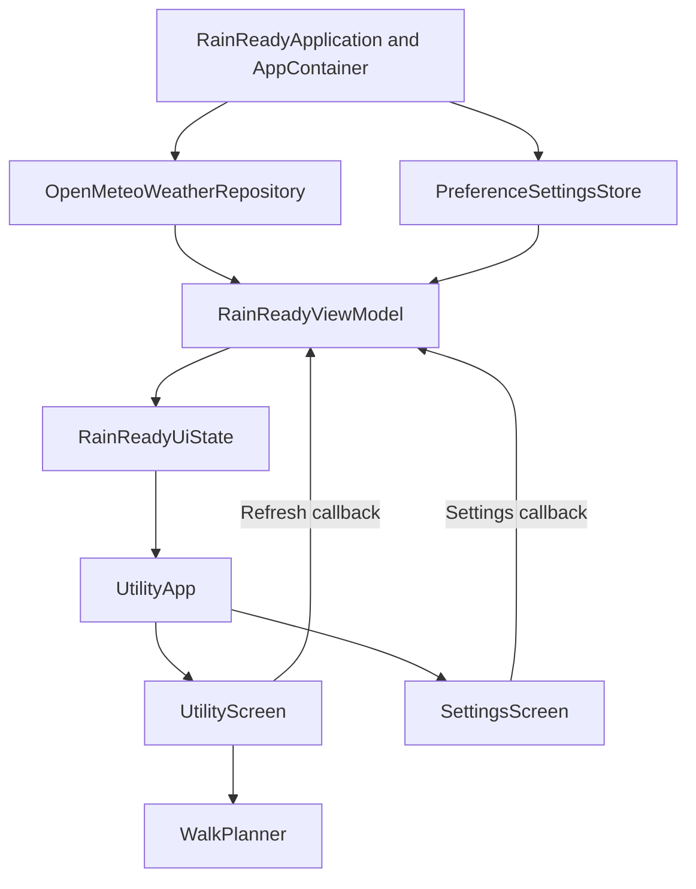

# Architecture

RainReady separates weather retrieval, walking decisions and screen rendering so that each can be understood and tested independently. The original two-tab Compose structure remains the entry point, while the counter has been replaced by a complete weather-based utility.

## State and dependency flow

`MainActivity` obtains its ViewModel from the application container and uses `collectAsStateWithLifecycle`. Screens receive immutable state and callbacks; they never create Retrofit services or write preferences directly. `UtilityApp` saves the selected tab with `rememberSaveable`. Its clock updates while the lifecycle is started so that a plan and its freshness are re-evaluated as time advances.

`RainReadyViewModel` exposes `StateFlow<RainReadyUiState>`. A state contains the selected `UserSettings`, an optional `WeatherForecast`, the loading flag and an optional user-facing error. An initial request starts at ViewModel creation. A refresh clears the error and marks loading; success replaces the forecast; failure keeps the last successful forecast only when it belongs to the currently selected city.

Changing city immediately removes the old city's data and starts a request. Duration, probability and unit changes update preferences and recompute the display without a redundant network request. SharedPreferences preserves choices across process restarts, and `SavedStateHandle` restores saved instance choices. Cancellation and a monotonically increasing request generation prevent an earlier refresh or a slow response for another city from replacing newer state.

## Remote service and validation

`OpenMeteoApi` calls `https://api.open-meteo.com/v1/forecast` through Retrofit and Gson. It requests two forecast days, Celsius temperatures, precipitation probabilities, weather codes, `timezone=auto` and Unix timestamps. OkHttp provides finite connect, read and total-call timeouts. Cleartext network traffic is disabled in the manifest.

`OpenMeteoWeatherRepository` translates the service response into domain objects and supplies a retrieval timestamp through an injectable clock. It validates the time zone and matching hourly-array lengths. Incomplete individual intervals are omitted; an empty usable result is rejected. Missing probability is never silently converted to zero.

The API's precipitation probability applies to the preceding hour. For response index `i`, the domain interval starts at `time[i]` and uses probability `i + 1`; the final unpaired interval is omitted. Adjacent epoch values must differ by exactly 3,600 seconds. Temperature and weather code at `i` remain samples associated with the start of that interval. This avoids displaying the previous hour's rain risk as the next hour's forecast. The interval convention follows the [Open-Meteo API documentation](https://open-meteo.com/en/docs).

## Walking-window decision

`WalkPlanner.findWindow` has no Android, networking or storage dependency. Its inputs are a forecast, user settings and the current local date/time in that forecast's zone.

1. Reject a mismatched city or invalid input ranges.
2. Establish a deadline six elapsed hours after the supplied evaluation instant, using the forecast zone before converting back to local time.
3. Consider departure now, then the next whole hour and subsequent whole hours in chronological order.
4. For each candidate, require the entire walk to finish at or before the deadline.
5. Examine every hourly interval with a non-zero overlap with the walk. Reject missing or duplicated intervals, out-of-range probabilities, unknown weather codes, non-finite temperatures, thunderstorms or any probability above the selected threshold.
6. Return the first qualifying window, its maximum hourly probability, and temperature weighted by the number of walk seconds falling in each sampled hour.

The intervals are half-open: a walk ending exactly at 11:00 does not overlap the 11:00–12:00 interval. A walk ending at 11:01 does. The probability threshold is inclusive. For example, 30% qualifies when the limit is 30%; 31% does not. The maximum value is an hourly risk summary, not a mathematical estimate of the probability of rain at any time during the whole walk.

The planner rejects an ambiguous or nonexistent current local time, ambiguous or nonexistent departure/end local times, duplicated local-hour data and walks whose actual zoned elapsed time differs from the requested duration. This intentionally conservative behaviour avoids inventing a walk across a daylight-saving transition. Singapore, Townsville and Brisbane normally avoid seasonal clock changes, while Melbourne makes this handling relevant.

## Presentation and accessibility

The main card is the primary decision output. It distinguishes immediate departure, later departure, no qualifying window, loading, unavailable data and a stale forecast. At 60 minutes of age, an existing forecast remains readable but its recommendation is suppressed. A failed refresh displays its error and retained-data notice with an explicit retrieval timestamp. A future departure is never labelled as departure now, even if it is less than one minute away.

The hourly outlook includes the current partial hour and following bins, up to seven cards, because a six-hour horizon can overlap seven hourly intervals. Labels explicitly describe hourly probabilities. The screen shows the location time zone, source attribution and the limits of forecast precision.

Material 3 components use a restrained teal-and-cream light scheme and a matching dark scheme. Both screens scroll; cards and text grow vertically instead of truncating important information. Settings options wrap with available width. Controls have at least 48 dp touch targets, headings expose heading semantics, combined hourly descriptions support screen readers, and recommendation/error changes use polite live announcements.

## Scope and trade-offs

The application uses fixed city coordinates instead of requesting device location. This keeps permission needs small and gives a clear setting without a geocoding service. Forecast state is retained in the ViewModel but is not written to an offline database; a fresh process fetches again. The app performs no scheduled background work and contains no accounts, route tracking, advertising or analytics SDK. Preview/test forecasts are confined to tooling and test code, and never mask a live-request failure.

